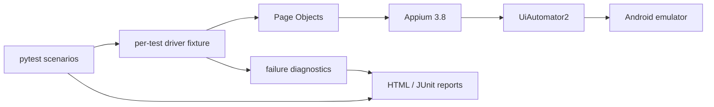

# Qualivanta

[](https://github.com/Ashu-3180/Qualivanta/actions/workflows/android-tests.yml)

Qualivanta is a Python/Appium Android test automation framework for Sauce Labs’ My Demo App. It demonstrates maintainable Page Object Model design, deterministic synchronization, evidence-first diagnostics, and reproducible GitHub Actions execution.

## Current quality signal

The hosted CI baseline is **12 passed, 0 failures, 0 errors, 0 skipped**. Test execution took **266.63 seconds**; the complete GitHub Actions workflow finished in **6m46s**. The local development target is Android API 37. CI uses Android API 35, which corresponds to the Android 15 platform; these are separate emulator configurations.

## Technology stack

- Python 3.14.4, pytest 9.1.1, pytest-html 4.2.0
- Appium 3.8.0, Appium-Python-Client 6.0.7, Selenium 4.51.0
- UiAutomator2 driver 8.7.0
- Java 27 and Android Studio Emulator
- Sauce Labs My Demo App for Android 2.3.0
- GitHub Actions with a hosted Android API 35 emulator

## Engineering features

- Page Objects for catalog, product details, cart, checkout, and confirmation flows.
- Explicit waits and verified Appium resource IDs; no coordinate-driven interactions or arbitrary sleeps.
- Centralized settings and W3C capabilities with local/CI environment overrides.
- Per-test driver lifecycle with failure screenshots, page source, bounded Logcat, and error context.
- APK download and validation support, plus HTML and JUnit reporting.
- CI artifact upload configured to preserve reports and diagnostics on failures.

## Automated coverage

| Area | Tests |
|---|---:|
| Smoke and catalog | 6 |
| Cart | 2 |
| Checkout | 4 |
| **Implemented total** | **12** |

The test inventory contains **50 documented cases**, approximately **27 automation candidates**, and **12 implemented automated tests**. The remaining cases are intentionally documented as manual, diagnostic, unsupported, or future-evaluation work. See [docs/test_cases.md](docs/test_cases.md).

## Architecture



The implementation boundaries are described in [docs/architecture.md](docs/architecture.md).

## Visual evidence

The repository includes a genuine app-only inspection capture at [docs/screenshots/app-splash.png](docs/screenshots/app-splash.png), copied from the timestamped source in `docs/app_inspection/`. No desktop, browser, terminal, or emulator-control chrome is included. A catalog screenshot is not presented here because the available capture shows the app launch screen rather than the product catalog.

## Run locally

From the repository root, with the `Qualivanta_API_37` emulator booted and Appium listening at `http://127.0.0.1:4723`:

```powershell
python -m venv .venv
.\.venv\Scripts\Activate.ps1
python -m pip install -r requirements.txt
.venv\Scripts\python.exe -m pytest -q
```

Useful focused commands:

```powershell
.venv\Scripts\python.exe -m pytest -q -m smoke
.venv\Scripts\python.exe -m pytest -q tests/test_catalog.py tests/test_cart.py tests/test_checkout.py
.venv\Scripts\python.exe -m pytest -q --html=reports/pytest.html --self-contained-html --junitxml=reports/junit.xml
```

See [docs/environment_setup.md](docs/environment_setup.md) and [docs/testing_and_ci.md](docs/testing_and_ci.md) for setup, diagnostics, and reporting details.

## CI and reports

The workflow at [.github/workflows/android-tests.yml](.github/workflows/android-tests.yml) provisions Python, Java, Node.js, Appium, UiAutomator2, the verified APK, and an Android API 35 emulator. It runs the full suite sequentially and uploads `reports/` and `artifacts/` even when a test fails. Local runs write HTML to `reports/pytest.html`, JUnit XML to `reports/junit.xml`, and runtime diagnostics under `artifacts/`.

## Repository guide

- [Architecture](docs/architecture.md)
- [Environment setup](docs/environment_setup.md)
- [Testing and CI](docs/testing_and_ci.md)
- [Test plan](docs/test_plan.md)
- [50-case test inventory](docs/test_cases.md)
- [Defect template](docs/defect_template.md)

## License

Qualivanta’s original automation framework, test code, scripts, and documentation are released under the MIT License. See [LICENSE](LICENSE).

Sauce Labs My Demo App for Android is a third-party application used for testing and is not covered by Qualivanta’s MIT License. See [THIRD-PARTY-NOTICES.md](THIRD-PARTY-NOTICES.md).
